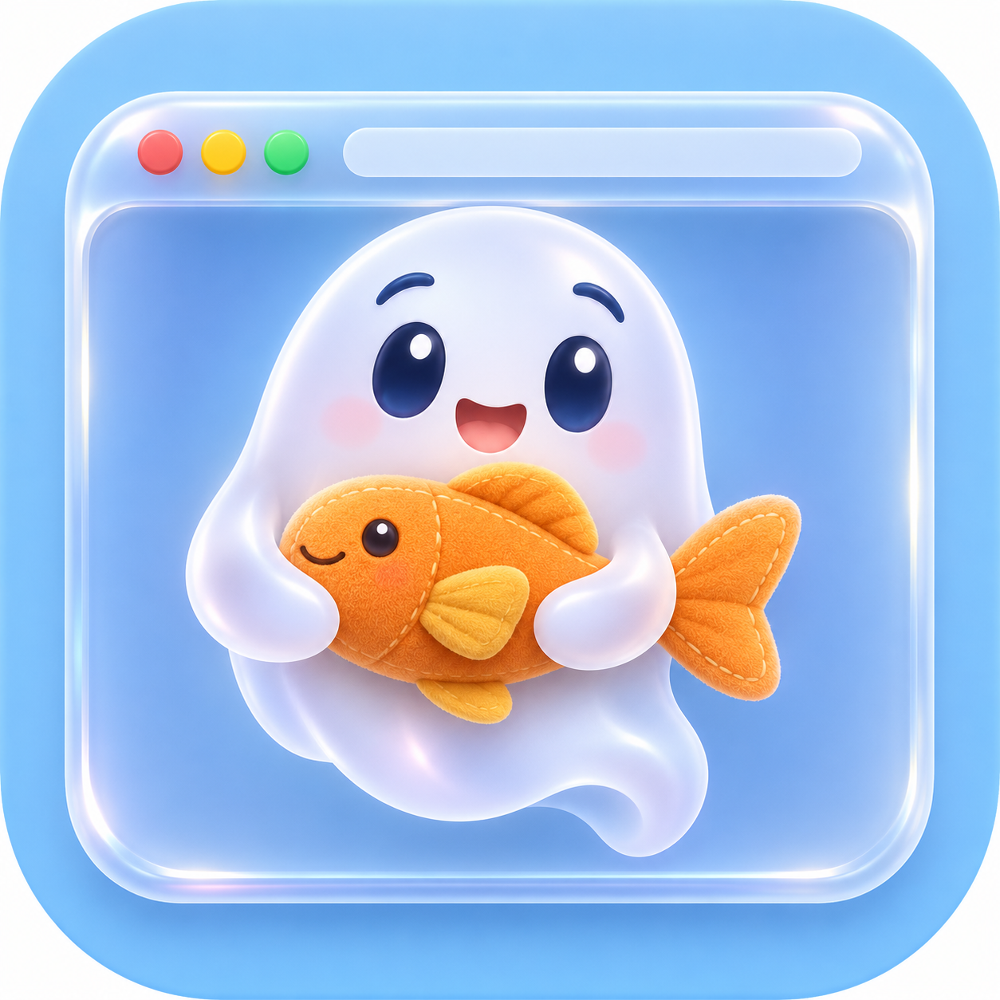

# GhostFish



摸鱼用的浮动浏览器：一个窗口，浮在别的窗口上面，能调到若隐若现，还能让鼠标点击直接穿过去。托盘菜单可以切换穿透、显示或隐藏窗口，也可以使用全局快捷键；macOS 上可以用设置界面改不透明度范围和快捷键。

## 下载

不想自己编译的话，到 [Releases](https://github.com/iWorld-y/GhostFish/releases) 取一个文件即可：

| 文件 | 适用 |
| --- | --- |
| `GhostFish-<版本>.dmg` | macOS，Apple 芯片和 Intel 芯片 |
| `ghostfish-darwin-arm64` | macOS，Apple 芯片 |
| `ghostfish-darwin-amd64` | macOS，Intel 芯片 |
| `ghostfish-linux-amd64` | Linux，x86_64 |
| `ghostfish-windows-amd64.exe` | Windows，64 位 |

macOS 用户可以打开 DMG，把 `GhostFish.app` 拖到 Applications，再从访达启动。应用包使用临时签名，未使用 Developer ID 签名，也未经过 Apple 公证；独立命令行程序同样未经公证。macOS 可能阻止首次打开。确认下载来源可信后，先尝试打开应用，再到「系统设置」的「隐私与安全性」中选择「仍要打开」；较旧的系统版本可能显示「系统偏好设置」。具体步骤见 [Apple 支持文档](https://support.apple.com/zh-cn/102445)。

`./ghostfish -version` 打印版本号；从源码直接构建出来的是 `dev`。

## 跑起来

需要 Go 1.27.3 或更高。项目使用上游 MyGo，编译时 Go 会按 `go.mod` 按需下载依赖。

```sh
go build -o ghostfish ./cmd/ghostfish
./ghostfish
./ghostfish https://example.com
```

- 不带网址启动时打开空白标签页；带网址启动时在第一个标签页打开该网址。
- 启动网址或地址栏网址不写协议时自动补 `https://`，只接受 HTTP 和 HTTPS。
- 显式提供无效网址时打印错误并以非零状态退出；多给几个网址只认第一个。
- 原先依赖不带网址退出的脚本，需要在启动前自行检查参数。
- 想在终端里直接跑也行：`go run ./cmd/ghostfish https://example.com`。

## 标签页和地址栏

点击标签栏中的 `+` 打开空白标签页，地址栏会获得输入焦点。输入网址后按回车，在当前标签页打开；网页开始显示后地址栏隐藏，其他已打开网页的标签页也不显示地址栏。首次加载失败时会保留网址和错误提示，供修改后重试。地址栏不支持关键词搜索。

点击标签切换网页；关闭按钮显示在当前标签内，点击后关闭该标签。关闭最后一个标签页会关闭窗口并退出。标签页不会在应用重启后恢复。

## 拖动窗口

macOS 默认按住 Command，在窗口内容区域任意位置按住鼠标左键拖动，即可移动窗口。松开左键后窗口停止移动。也可以在设置中选择其他拖动修饰键组合；开始拖动时，Command、Control、Option 和 Shift 的按下状态必须与所选组合完全一致。

没有匹配拖动组合时，网页和控件的鼠标交互保持原样。匹配组合时，单击可能被拦截；例如选择 Control 后，Control 加单击可能无法打开上下文菜单。窗口开启点击穿透时，鼠标操作仍会交给下层窗口。

## 托盘和快捷键

点击 macOS 菜单栏、Windows 通知区域或 Linux 托盘中的 GhostFish 图标，可以切换「鼠标穿透」、隐藏或显示窗口，以及退出应用。隐藏只隐藏窗口，不关闭网页；关闭窗口、关闭最后一个标签页或选择退出会结束应用。设置界面打开时窗口保持可点，托盘中的穿透勾选显示保存的配置，关闭设置后再按恢复条件应用。

托盘创建失败或无法确认 Linux 托盘宿主时，应用会显示独立提示并继续启动。托盘不可用时，只有对应的穿透或隐藏快捷键已注册，才允许进入该状态；运行中宿主消失时，应用会关闭无法恢复的穿透或显示无法恢复的窗口。Linux 会周期性检查宿主以及本进程的托盘项是否已注册，短暂查询失败有宽限期，持续无法确认时按不可用处理。

下边是默认快捷键，macOS 上可以在设置里修改；Windows 和 Linux 固定使用这些键位。

| 快捷键 | 作用 |
| --- | --- |
| `⌘⇧-` | 不透明度降低 10 个百分点 |
| `⌘⇧=` | 不透明度提高 10 个百分点 |
| `⌘⇧T` | 切换点击穿透 |
| `⌘⇧H` | 隐藏 / 显示窗口 |

不是 macOS 的话，`⌘` 换成 `Ctrl`。
macOS 上按住透明度快捷键可连续调整；其他平台遵循框架的快捷键行为。

## 设置

macOS 标签栏右侧的齿轮打开设置，用来改不透明度上下限、窗口拖动修饰键和四组全局快捷键。Windows 和 Linux 没有设置入口，继续使用固定范围和固定键位。

- 不透明度上下限是 0% 至 100% 的整数，下限不能大于上限，默认就是 0% 和 100%。保存后当前不透明度会限制到新范围内，快捷键每次仍然调整 10 个百分点；上下限相同时不透明度固定在这个值。0% 就是完全透明，窗口仍然存在：生效范围的上限大于 0% 时，按提高不透明度的快捷键能把它调回去；如果把上下限都设成 0%，提高快捷键也会停在 0%。这时要先退出程序，再把 `state.json` 里的上限（`max_opacity`）改成大于 0 的值并把 `opacity` 设为正数，或者删掉整个 `state.json`（会一并重置快捷键和穿透状态）后重启。
- 窗口拖动可以选择 Command、Control、Option 和 Shift 中的一个或多个键，默认只选 Command。拖动组合与四组全局快捷键分别保存。
- 四组快捷键每组需要 Command、Control 或 Option 中至少一个修饰键，可以再加 Shift。主键支持字母、数字、`-`、`=`、空格和 `F1`–`F12`，四组不能重复；平台注册不了的主键在保存时会被拒绝。
- 编辑只改草稿：取消、关闭设置或按 Escape 都不保存；正在录入快捷键时按 Escape 只取消这次录入。
- 注册失败时设置界面标出不可用的动作，保留输入供修改；原配置和可恢复的旧快捷键继续生效。穿透或隐藏快捷键恢复不了时，窗口先恢复可见、不穿透，终端和界面会说明实际结果。之后仍可使用托盘或相应的可用快捷键主动切换状态。
- 设置界面打开期间窗口不进入穿透，关闭设置后再按生效的穿透状态恢复；录入快捷键时窗口也保持可点，即使窗口失去焦点也能点回来取消。

macOS 的全局快捷键是跨应用共享的：其他应用可以同时使用同一组合，注册成功也不代表本应用一定能收到按键。系统或其他应用拦截按键时可能无法用快捷键恢复穿透或隐藏，建议选择不会被占用的组合。

## 需要密码的站点

启动网址或地址栏提交的网址要求 HTTP Basic 认证时，应用在后台探测，并按顺序尝试环境变量 `GHOSTFISH_AUTH=用户名:密码`、系统钥匙串和终端输入。终端输入密码时不会回显；图形启动没有终端时，应用会显示认证窗口，让用户输入用户名和密码。

认证窗口显示主机和认证范围。密码输入会遮挡，密码错误时可以修改后重试，也可以取消。窗口独立于主浏览器窗口，浏览器隐藏、透明或穿透时仍可操作。切换标签页时，原标签页的认证窗口会暂时隐藏，切回后可继续输入。关闭标签页或窗口，或导航到其他地址时，待处理的认证会取消。如果终端已经在等待输入，输入结束前其他终端提示仍需等待。

探测失败或网址重定向后，如果 WebView 对当前主文档收到 Basic 质询，应用仍会处理。跨来源重定向需要用户重新输入，应用不会自动把原网址的凭据交给新来源。代理、其他主机和非 Basic 质询不会获得当前凭据。主文档提交后，应用不处理子资源的认证质询。

页面切换期间，WebView 接口不提供发出质询的资源地址，因此无法可靠区分同主机同端口的子资源质询。Linux 上如果网页链接跳转时页面地址尚未更新，应用可能跳过主文档质询；可以打开新标签页并输入目标网址。

应用只在凭据通过请求校验且已被 WebView 使用后尝试写入钥匙串。凭据按协议、主机、端口和认证范围分别保存和复用。旧版本按主机保存的条目会保留，但无法确认其范围，因此应用不会自动读取，需要重新输入。校验无法判断时，WebView 仍可尝试登录，但应用不会保存该凭据。应用不会把密码写入普通状态文件或日志。网址里直接写 `https://用户名:密码@主机/` 仍交给 WebView 处理。Windows 上如果 WebView2 运行时过旧，不提供认证回调，则由该运行时的默认认证行为处理。

## 状态保存在哪

- 不透明度、穿透开关，以及 macOS 的设置（不透明度范围、拖动修饰键和四组快捷键）：应用数据目录下的 `state.json`。
- 窗口位置和尺寸：同目录下的 `window-state.json`，由框架负责。

macOS 上是 `~/Library/Application Support/GhostFish/`，Linux 是 `~/.config/GhostFish/`，Windows 是 `%AppData%\GhostFish\`。

macOS 上不透明度在 0%–100% 之间，并受设置里的上下限限制，每次调整 10 个百分点，第一次启动默认 85%；Windows 和 Linux 固定 20%–100%。旧版本留下的状态文件缺少设置字段时，应用使用默认范围（0%–100%）和默认快捷键，原有的不透明度和穿透状态照常恢复；新增字段损坏时只回退对应部分，不会丢掉能独立读取的旧状态。状态文件整体损坏或取值超出范围时回落到默认值，不会挡住启动；显式保存的 0% 会被保留，和缺少 `opacity` 字段（用默认 85%）区分。

从终端启动时，当前不透明度和穿透状态也会打印到终端。托盘菜单显示穿透配置和显示或隐藏操作。

## 平台

- macOS 12 及以上：WebKit 自带，无需额外依赖。
- Windows 10/11：需要 WebView2 运行时。
- Linux：需要 GTK 3、WebKitGTK 4.1（或 4.0）、`libayatana-appindicator3` 和支持 StatusNotifier 的桌面托盘宿主。不同发行版的包名可能不同；没有托盘宿主时仍可使用已注册的快捷键。

单文件二进制，纯 Go，不需要 cgo。

## 已知限制

- 透明是整窗变淡，字也会跟着淡，40% 以下看内容就费劲了。
- 0% 是完全透明：上下限都设成 0% 后提高快捷键也停在 0%，只改 `state.json` 里的 `opacity` 没用，重启后仍会被范围夹回 0%；要先退出程序，把 `max_opacity` 改成大于 0 的值并设置 `opacity`，或者删掉整个 `state.json`（快捷键和穿透状态也会重置）。全透明窗口能不能被鼠标点中也还没有验证。
- 托盘或快捷键可能因桌面环境、系统或其他应用而不可用；应用会报告已知的注册失败，并限制没有恢复入口的动作。
- 快捷键是全局的，运行期间会占用系统里其他应用的同一组组合键；macOS 允许其他应用共享同一组合，也可能被系统或其他应用拦截，此时可以打开设置改用别的组合。
- 页面兼容性跟着系统 webview 走，macOS 上就是 Safari 内核，个别站点可能要求 Chromium。
- 关窗口即退出应用。

## 开发

```sh
go test ./...
go vet ./...
```

### 构建和发布

`mygo.json` 的 `version` 是应用包和发布工作流的版本来源。从 `v4` 起使用正整数，每次发布递增 1，例如 `v4`、`v5`、`v6`；配置中只写数字字符串，例如 `"4"`，不加 `v`，不使用前导零、小数或预发布后缀。已有的 `v0.x.0` 标签保留。更新版本后，推送与其一致的 `vN` 标签会触发测试、四个命令行程序和通用 DMG 的构建与校验。全部通过后，工作流先创建草稿 Release，确认五个资产上传完成再发布；已有 Release 或草稿不会被覆盖。构建失败不会发布不完整的 Release。手动运行工作流只生成可下载的 Actions 产物，不创建 Release。

本机可用 `go run github.com/egoist/mygo/cmd/mygo@v0.8.3 build -platform darwin/universal -o dist` 构建通用应用；生成 DMG 和临时签名需要 macOS。

代码按功能组织，根目录保留模块、构建配置和项目说明，Go 入口放在 `cmd/ghostfish/`：

| 目录或文件 | 职责 |
| --- | --- |
| `cmd/ghostfish/` | 启动参数、版本查询和退出码；使用 `go run ./cmd/ghostfish`，版本仍通过 `-X main.version` 注入 |
| `internal/app/` | 创建主窗口，组装浏览器、设置和桌面组件，安排启动顺序 |
| `internal/browser/` | 标签页、地址栏、网页导航、导航取消，以及跟随标签页的认证窗口 |
| `internal/auth/` | HTTP Basic 探测、凭据验证、环境变量、钥匙串和终端输入 |
| `internal/config/` | 设置数据、默认值、校验、状态文件读写与损坏回落；读取时显式传入平台能力 |
| `internal/settings/` | 设置草稿、快捷键录入和设置界面，通过 `Host` 接口调用桌面操作 |
| `internal/desktop/` | 窗口透明度与穿透、显示与隐藏、托盘、快捷键、原生拖动和恢复规则 |
| `assets/` | 图标文件与托盘图标嵌入 |
| `script/` | 发布脚本及对应测试 |

`app` 负责组件组装，`browser` 调用 `auth`，`settings` 和 `desktop` 使用 `config`。设置界面只持有编辑草稿，生效状态由 `desktop` 持有；浏览器通过回调打开设置，不直接依赖设置组件。平台实现留在所属功能包中，用 `_darwin.go`、`_linux.go` 和构建标签隔离。

单元测试随组件存放，设置与窗口恢复的联合测试放在 `internal/desktop/`。GUI 测试需要 macOS，并通过 `gui` 构建标签和 `GHOSTFISH_GUI=1` 显式启用。以下命令分别检查原生托盘和标签页认证窗口：

```sh
GHOSTFISH_GUI=1 go test -tags gui ./internal/desktop -run '^TestTrayNativeSmoke$' -count=1
GHOSTFISH_GUI=1 go test -tags gui ./internal/browser -run '^TestAuthWindowsFollowTabs$' -count=1
```

行为规格在 `openspec/specs/`，提案与设计文档归档在 `openspec/changes/archive/`。
